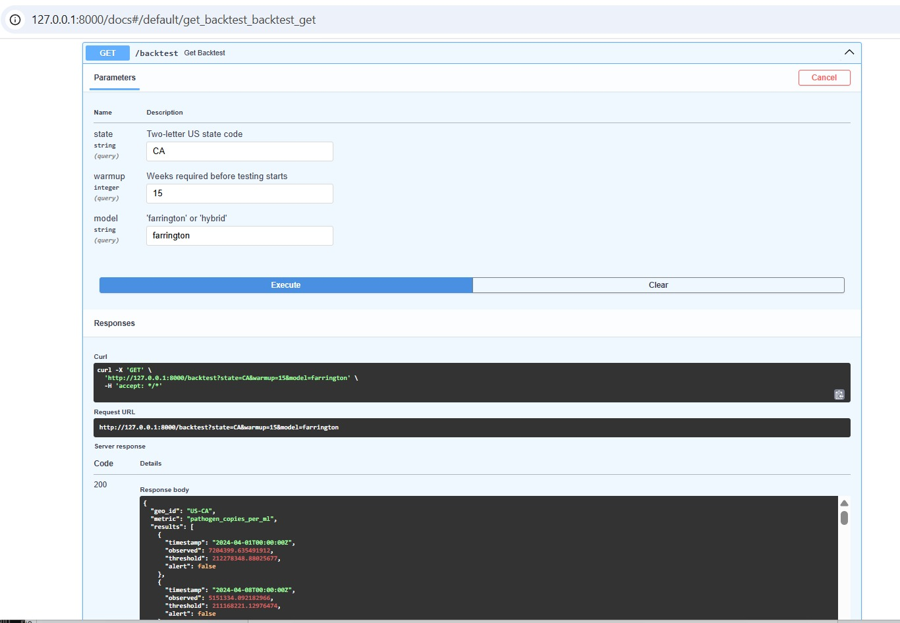

<div align="center">

# 🚨 Argus Platform

**Federated, standards-compliant early-warning infrastructure for epidemiological surveillance.**

[](https://github.com/famenaghawon/argus-platform/actions/workflows/ci.yml)
[](https://www.python.org/downloads/)
[](#testing--verification)
[](LICENSE)
[](https://doi.org/10.5281/zenodo.23611284)

*Fuses wastewater, clinical, and open-source event data into a unified weekly signal, detects outbreaks with statistically rigorous baselines and hybrid neural-mechanistic models, and exposes everything through a validated FastAPI service.*

</div>

---

## 📖 What Argus Is (and Is Not)

Argus is a **research-grade data-fusion and outbreak-detection platform**, not a diagnostic tool. It ingests public and semi-public surveillance data, aligns it to a common temporal index, runs detection algorithms with quantified false-alarm characteristics, and returns **calibrated signals that require human epidemiological review**.

### What It Is
- ✅ A **verifiable** multi-source ingestion pipeline with recorded HTTP cassettes proving every live data fetch
- ✅ A **tested** detection tier: statistically classical (Farrington) and hybrid neural-mechanistic (SEIR + residual)
- ✅ A **deployable** API service with structured logging, health checks, and Docker containerization
- ✅ **Standards-aware**: reads DHIS2 Web API and FHIR R4, writes into an `Observation` contract designed for interoperability

### What It Is Not
- ❌ **Not a diagnostic tool.** Alerts are statistical signals, not clinical assessments.
- ❌ **Not a replacement for national IHR focal points.** Every alert requires human review.
- ❌ **Not federated yet.** The `argus.federated` module contains interface stubs, not working cross-institution training.
- ❌ **Not clinically validated.** The models are implemented correctly, but have not been evaluated against a multi-year gold-standard outbreak dataset.

*Full disclosure in [`docs/limitations.md`](docs/limitations.md).*

---

## 🏗️ Architecture

```
┌─────────────────────────────────────────────────────────────────────────────┐
│                              INGESTION LAYER                                │
│                                                                             │
│  ┌────────────┐   ┌────────────┐   ┌────────────┐   ┌────────────┐          │
│  │    CDC     │   │   DHIS2    │   │   GDELT    │   │   ERA5     │          │
│  │   NWSS     │   │ Web API    │   │   2.0      │   │  Climate   │          │
│  │ (Socrata)  │   │ (JSON)     │   │ (zip TSV)  │   │ (CDS API)  │          │
│  └─────┬──────┘   └─────┬──────┘   └─────┬──────┘   └─────┬──────┘          │
│        │                │                │                │                 │
└────────┼────────────────┼────────────────┼────────────────┼─────────────────┘
         │                │                │                │
         ▼                ▼                ▼                ▼
┌─────────────────────────────────────────────────────────────────────────────┐
│                          OBSERVATION CONTRACT                               │
│                  (Pydantic v2 — strict UTC + geo + metric)                  │
└──────────────────────────────────┬──────────────────────────────────────────┘
                                   │
                                   ▼
┌─────────────────────────────────────────────────────────────────────────────┐
│                              FUSION LAYER                                   │
│   align_weekly()  ──►  dedup + quality gates + Monday-anchored tz-aware     │
└──────────────────────────────────┬──────────────────────────────────────────┘
                                   │
                                   ▼
┌─────────────────────────────────────────────────────────────────────────────┐
│                             DETECTION TIER                                  │
│                                                                             │
│   ┌─────────────────────────┐        ┌──────────────────────────────┐       │
│   │  Farrington (baseline)  │        │   Hybrid (SEIR + ResidualNN) │       │
│   │  log-normal, OLS        │        │   mechanistic + learned      │       │
│   └────────────┬────────────┘        └───────────────┬──────────────┘       │
│                │                                     │                      │
│                └──────────────┬──────────────────────┘                      │
│                               ▼                                             │
│                    ┌─────────────────────┐                                  │
│                    │  Rolling-origin     │                                  │
│                    │  Backtest Engine    │                                  │
│                    └──────────┬──────────┘                                  │
│                               │                                             │
└───────────────────────────────┼─────────────────────────────────────────────┘
                                │
                                ▼
┌─────────────────────────────────────────────────────────────────────────────┐
│                       EVALUATION & DELIVERY                                 │
│                                                                             │
│   Sensitivity · Specificity · False Alarm Rate · Lead Time                  │
│                                                                             │
│   ┌───────────────────────────────────────────────────────────────────┐     │
│   │        FastAPI Service  ( /observations /backtest /alerts )        │     │
│   │     Model selection:  ?model=farrington   ?model=hybrid            │     │
│   └───────────────────────────────────────────────────────────────────┘     │
└─────────────────────────────────────────────────────────────────────────────┘
```

---

## 🚀 Quick Start

### Live API (Production)
The API is publicly deployed via Render and Cloudflare:
👉 **[https://api.savflux.com/docs](https://api.savflux.com/docs)**


### Interactive API Documentation


### Option A — Local (Python)

```bash
git clone https://github.com/famenaghawon/argus-platform.git
cd argus-platform

conda create -n argus python=3.11 -y
conda activate argus

# Install with dev dependencies
pip install torch torchvision --index-url https://download.pytorch.org/whl/cpu
pip install -e ".[dev]"

# Run the API
make api
# → http://127.0.0.1:8000/docs
```

### Option B — Docker

```bash
docker compose up -d
# → http://127.0.0.1:8000/docs
```

### Try It

```bash
# Health check
curl http://127.0.0.1:8000/health

# Raw observations (NWSS California)
curl "http://127.0.0.1:8000/observations?state=CA"

# Farrington backtest
curl "http://127.0.0.1:8000/backtest?state=CA&model=farrington"

# Hybrid backtest (slower: trains per-week)
curl "http://127.0.0.1:8000/backtest?state=CA&model=hybrid&warmup=10"

# Detection metrics
curl "http://127.0.0.1:8000/alerts?state=CA&p90_window=6"
```

---

## 📦 Data Sources — Live vs. Stubbed

Every row in the **Live** column has a VCR cassette in [`tests/integration/cassettes/`](tests/integration/cassettes/) proving the ingestor hit the real endpoint. CI replays those cassettes offline — the tests are deterministic and don't require network access.

| Source | Status | Endpoint | Auth |
|---|---|---|---|
| **CDC NWSS Wastewater** | ✅ Live | `data.cdc.gov/resource/g653-rqe2` | Public |
| **DHIS2 Analytics** | ✅ Live (demo) | `play.im.dhis2.org/stable-2-40-12` | HTTP Basic |
| **GDELT 2.0 Events** | ✅ Live | `data.gdeltproject.org/gdeltv2/lastupdate.txt` | Public |
| **ERA5 Climate** | ⚠️ Implemented | Copernicus CDS API | `~/.cdsapirc` required |
| **FHIR R4** | ⚠️ Format-verified | Synthea-generated bundles | File-based |
| **SORMAS** | ⏳ Interface only | REST API stubs | — |
| **Twitter / X** | ❌ Not integrated | Replaced by GDELT | — |

---

## 🧪 Testing & Verification

```bash
make test            # All 25 tests
make test-integration # 5 tests · live ingestion via cassettes
make test-eval       # 3 tests · Farrington + hybrid backtest
make test-api        # 5 tests · HTTP endpoints via TestClient
```

```
tests/unit/         10 tests · schema validation, math, alignment
tests/fixtures/      2 tests · synthetic outbreak + quiet period
tests/integration/   5 tests · live data ingestion (cassette-replayed)
tests/evaluation/    3 tests · Farrington + hybrid detection
tests/api/           5 tests · HTTP endpoints
                    ───
                    25 tests · all passing in ~9s
```

### What "Cassette-Verified" Means

Each integration test records the exact HTTP exchange (URL, request, response) into a YAML file under `tests/integration/cassettes/`. On subsequent runs, VCR intercepts the HTTP call and replays the recorded response. Consequences:

1. **CI never needs network access** — so tests are fast, deterministic, and immune to upstream endpoint changes during a test run.
2. **The cassettes themselves are the audit artifact** — anyone can read `test_nwss_ca_returns_observations.yaml` and see the raw CDC response that the code was validated against.
3. **When CDC/GDELT/DHIS2 change**, only the affected cassette needs re-recording — the actual assertion logic stays untouched.

To record fresh cassettes (e.g., after a schema change at the source):

```bash
rm tests/integration/cassettes/*.yaml
pytest tests/integration -v
```

---

## 🔬 Detection Models

### Farrington Baseline (log-normal variant)

The canonical outbreak-detection algorithm, adapted for continuous-valued surveillance signals.

- **Input:** weekly observed values (e.g., copies/ml)
- **Method:** log1p → OLS with trend + annual Fourier terms → upper bound = `expm1(μ_log + z·σ)`
- **Reference:** [Farrington et al. (1996)](https://doi.org/10.1111/j.1467-985X.1996.tb00774.x)
- **Model card:** [`docs/model_cards/farrington.md`](docs/model_cards/farrington.md)

```python
from argus.models.baselines.farrington import farrington_threshold
thresh = farrington_threshold(history, z_threshold=1.96)
```

### Hybrid SEIR + Residual Neural Net

Mechanistic backbone (deterministic SEIR ODE) with a learned MLP residual.

- **Input:** weekly observed values (≥ 60 weeks recommended)
- **Method:** SEIR prediction + learned residual on log scale + normal quantile
- **Model card:** [`docs/model_cards/hybrid_seir.md`](docs/model_cards/hybrid_seir.md)

```python
from argus.models.hybrid.hybrid_model import HybridDetector
detector = HybridDetector(epochs=40)
detector.fit(train_series)
thresh = detector.predict_threshold(train_series, z=1.96)
```

---

## ⚖️ Evaluation

The backtest engine computes four metrics from a rolling-origin replay:

| Metric | Meaning |
|---|---|
| **Sensitivity** | Fraction of detected onsets |
| **Specificity** | 1 − false alarm rate |
| **False Alarm Rate** | Alerts outside ±2 weeks of an onset, per quiet week |
| **Lead Time** | Days between first alert and defined onset |

Onset definition: first week of a run where `observed > trailing_p90` for ≥ 2 consecutive weeks.

```python
from argus.evaluation.backtest import run_farrington_backtest
from argus.evaluation.metrics import compute_metrics

results = run_farrington_backtest(df, "pathogen_copies_per_ml", "US-CA", warmup=20)
metrics = compute_metrics(results, p90_window=6)
# → {'sensitivity': ..., 'specificity': ..., 'false_alarm_rate': ..., 'lead_time_median_days': ...}
```

---

## 📊 API Reference

| Endpoint | Description |
|---|---|
| `GET /health` | Liveness probe |
| `GET /observations?state=CA` | Raw normalized NWSS observations |
| `GET /backtest?state=CA&model=farrington` | Weekly threshold backtest |
| `GET /backtest?state=CA&model=hybrid` | Same, using SEIR + residual model |
| `GET /alerts?state=CA&p90_window=6` | Detection metrics |

Full interactive docs at **`http://127.0.0.1:8000/docs`** (Swagger UI).

---

## 📂 Project Structure

```
argus-platform/
├── src/argus/
│   ├── ingestion/           # Live data connectors
│   │   ├── wastewater/      # CDC NWSS (Socrata CSV)
│   │   ├── dhis2/           # DHIS2 Web API
│   │   ├── news/            # GDELT 2.0
│   │   ├── climate/         # ERA5 (Copernicus)
│   │   ├── fhir/            # FHIR R4 bundles
│   │   └── schemas/         # Observation contract
│   ├── fusion/              # Temporal/spatial alignment
│   ├── models/
│   │   ├── baselines/       # Farrington
│   │   ├── hybrid/          # SEIR + ResidualNet
│   │   ├── gnn/             # (stub) Graph tier
│   │   └── registry.py      # MLflow integration
│   ├── evaluation/          # Backtest + metrics
│   ├── federated/           # (stub) Flower-based FL
│   ├── api/                 # FastAPI service
│   └── cli.py               # `argus` command-line
├── tests/
│   ├── unit/                # Pure logic, no I/O
│   ├── fixtures/            # Synthetic outbreak data
│   ├── integration/         # Live ingestion (cassette-backed)
│   ├── evaluation/          # Detection + backtest
│   └── api/                 # HTTP endpoints
├── docs/
│   ├── governance.md        # Data classification + DP
│   ├── interoperability.md  # DHIS2/FHIR standards
│   ├── limitations.md       # Honest known constraints
│   └── model_cards/         # ML model documentation
├── notebooks/               # Exploratory analysis
├── data/                    # Runtime artifacts (git-ignored)
├── Dockerfile
├── docker-compose.yml
├── Makefile
└── pyproject.toml
```

---

## 🛠️ Development

### Common targets

```bash
make help              # Show all targets
make install           # pip install -e ".[dev]"
make test              # Run all 25 tests
make test-integration  # Cassette-backed tests only
make test-eval         # Farrington + hybrid evaluation
make test-api          # HTTP endpoint tests
make lint              # ruff + mypy
make format            # ruff format
make clean             # Remove __pycache__, build artifacts
make pipeline          # Fetch NWSS + GDELT, fuse, write parquet
make api               # Run uvicorn
```

### CLI reference

```bash
argus wastewater --state CA         # Raw NWSS observations
argus dhis2 <uid> <org>             # DHIS2 analytics
argus news --iso NG                 # GDELT events
argus climate --geo NG              # ERA5 (requires ~/.cdsapirc)
argus fhir <bundle.json>            # FHIR R4 parser
argus pipeline                      # Full fusion pipeline
```

---

## 🔒 Data Governance

Argus **never stores individual-level records**. All ingestion is aggregated to `(geo_id, metric, timestamp, resolution)` before storage or transmission. The `Observation` Pydantic model enforces this at the type level.

For a full classification and DP roadmap, see [`docs/governance.md`](docs/governance.md).

---

## 🤝 Contributing

1. `make install` to set up the dev environment
2. `make test` must pass before submitting
3. New ingestors require a cassette-backed integration test
4. New models require a model card in `docs/model_cards/`

---

## 📚 Citing Argus

```bibtex
@software{argus_platform_2026,
  title  = {Argus Platform: Federated Public Health Early-Warning Infrastructure},
  author = {Ghawon, Famena and Contributors},
  year   = {2026},
  url    = {https://github.com/famenaghawon/argus-platform},
  note   = {Version 0.2.0}
}
```

---

## 📄 License

MIT — see [LICENSE](LICENSE).

---

<div align="center">

**Built with rigor, not wishful thinking.**

</div>
